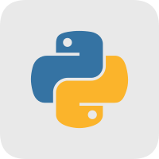

[English](README.md) | [中文](README.zh.md)

<div align="center">

<p align="center"> </p>

# Hello Python

<p align="center">
  
  
  
  
</p>

A Python knowledge base · [Read online](https://cuihairu.github.io/hello-python/)

</div>

---

A personal collection of Python notes, takeaways, and experience from a game developer's perspective. It records things learned while building software; it is a set of notes to share, not a course or learning path.

Knowledge base: [Core concepts](https://cuihairu.github.io/hello-python/knowledge/core-concepts) · [Books](https://cuihairu.github.io/hello-python/knowledge/books) · [Official docs](https://cuihairu.github.io/hello-python/knowledge/official-docs) · [Scenarios](https://cuihairu.github.io/hello-python/knowledge/scenarios) · [Pitfalls](https://cuihairu.github.io/hello-python/knowledge/pitfalls)

## Local development

```bash
npm install          # Install dependencies
npm run docs:dev     # Start the dev server
npm run docs:build   # Build to docs/.vitepress/dist
npm run docs:preview # Preview the build output locally
```

## Documentation checks

CI runs four gates on every push and pull request; run them locally before committing:

```bash
python3 scripts/verify_blocks.py   # Verify code block outputs match the docs
python3 scripts/check_anchors.py    # Verify internal links and anchors
python3 scripts/check_timeline.py    # Verify timeline data
python3 scripts/check_links.py      # Verify external links (CI is authoritative)
```

The build must also pass: `npm run docs:build`.

## Directory structure

```text
docs/
├── index.md         # Site home and overview
├── basics/          # Environment and language basics: syntax, types, control flow, functions
├── datastructures/  # Data structures: lists, dicts, strings, iterators
├── advanced/        # Language features: OOP, magic methods, decorators, type annotations
├── concurrency/     # Concurrency: threading, asyncio, multiprocessing
├── engineering/     # Engineering: standard library, testing, logging, packaging
├── internals/       # CPython source walkthroughs (with file and line references)
├── knowledge/       # Knowledge base: concepts, books, official docs, scenarios, pitfalls
├── glossary.md      # Cross-topic glossary
├── timeline.md      # Language history timeline
├── navigation.md    # Sidebar source and maintenance rules
├── public/          # Site assets
└── .vitepress/      # VitePress config and theme
```

The site navigation is maintained in `docs/.vitepress/sidebar.json`; see [Navigation maintenance](https://cuihairu.github.io/hello-python/navigation) before changing the sidebar.

## License

This work is published under the [Creative Commons Attribution 4.0 International (CC BY 4.0)](https://creativecommons.org/licenses/by/4.0/) license.
